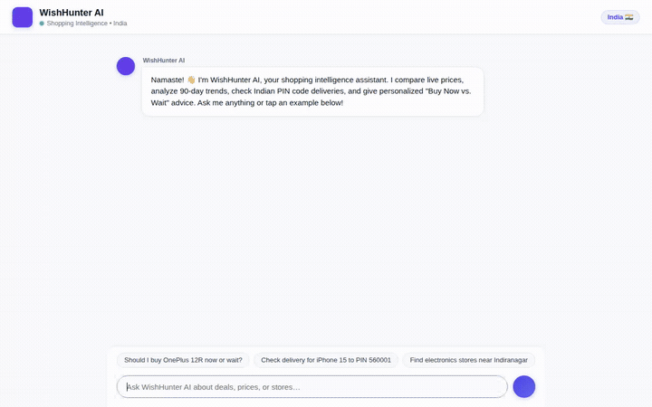

# WishHunter AI 🛍️

A conversational shopping intelligence agent designed for Indian consumers. WishHunter AI helps shoppers make confident purchasing decisions with cross-retailer offer comparisons, 90-day price-history analysis, local delivery verification, and personalized **"Buy Now vs. Wait"** recommendations.



---

## What WishHunter AI Does

WishHunter AI acts as an end-to-end shopping advisor that balances real-time market data with individual buyer constraints:

- **"Buy Now vs. Wait" Decision Engine**: Evaluates whether a deal is genuinely worth purchasing immediately or if the consumer should wait for an upcoming seasonal sale. It benchmarks current prices against 90-day medians and all-time historical lows while factoring in bank card promotions (e.g., instant HDFC or ICICI discounts) and user urgency horizons.
- **Cross-Retailer Price & Delivery Verification**: Searches catalog products across major Indian retailers (Amazon.in, Flipkart, Croma, Reliance Digital) and validates delivery feasibility for 6-digit Indian PIN codes.
- **Physical Store Discovery**: Resolves addresses, neighborhoods, and postal codes to geographic coordinates and locates nearby physical electronics stores and authorized retailers using Google Maps.
- **Persistent Wishlist & Price Alerts**: Tracks target prices, user notes, and urgency timelines in Cloud Firestore.
- **Allergy & Sensitivity Memory**: Tracks consumer sensitivities, allergies (e.g., nickel, latex, specific chemical compounds), and brand preferences across sessions, proactively flagging potential product risks.
- **Deterministic Financial Calculations**: Executes mathematical breakdowns, EMI schedules, and GST calculations inside a secure Python sandbox.
- **Multi-Modal Visualizations**: Generates AI product setups and aesthetic mood boards, storing assets in Google Cloud Storage and displaying them directly in the chat interface.
- **Dynamic A2UI Surface Rendering**: Returns structured Agent-to-User Interface (A2UI) cards for price comparison matrices, decision verdicts, and visual product mockups.

---

## Google Cloud Services & Architecture

| Service / Component | Purpose in WishHunter AI | Implementation Detail |
| :--- | :--- | :--- |
| **Vertex AI Agent Engine** | Agent reasoning and orchestration | Runs `gemini-3.8-flash` via Google ADK (`Agent`, `App`) on Reasoning Engine with A2A protocol support |
| **Vertex AI Memory Bank** | Long-term memory across sessions | `PreloadMemoryTool` and `add_session_to_memory()` callback preserve user preferences, PIN codes, and allergen restrictions |
| **Cloud Firestore** | Catalog and wishlist persistence | Stores `products` (pricing benchmarks, PIN delivery data) and `wishlists` (user targets and urgency) |
| **Vertex AI Code Sandbox** | Secure code execution | Executes Python code for exact financial calculations, EMI formulas, and savings analysis via `code_executor` |
| **Vertex AI Imagen** | Multi-modal generation | Generates gadget setups and visual mockups using `gemini-3.1-flash-lite-image` |
| **Google Cloud Storage** | Public media hosting | Stores generated image assets in a Cloud Storage bucket and serves public HTTPS URLs for A2UI rendering |
| **Google Maps Platform** | Location intelligence | Geocoding API resolves Indian addresses/PINs; Places API (New) searches nearby physical retail outlets |
| **A2UI (v0.8 Basic Catalog)** | Structured interface rendering | Intercepts agent responses to render rich Cards, Columns, Rows, Text hierarchy, and Images |

---

## Implemented Agent Tools

The agent (`app/agent.py`) is equipped with the following tools:

- `evaluate_buy_or_wait(product_id, urgency_days, bank_card)`: Analyzes historical price benchmarks, bank offers, and urgency to return a grounded `BUY NOW` or `WAIT` verdict with confidence scores.
- `search_products(query, category, pincode)`: Searches the Firestore product catalog and validates delivery eligibility for 6-digit Indian PIN codes.
- `get_product_details(product_id)`: Retrieves comprehensive specifications, multi-retailer offers, MRP, 90-day medians, and historical lows.
- `save_to_wishlist(product_id, target_price, urgency_days, notes, user_id)`: Saves or updates a tracked item with target price alerts in Firestore.
- `get_wishlist(user_id)`: Fetches active tracked items and alert thresholds for the user.
- `update_product_price(product_id, new_price, retailer)`: Updates live retailer prices and adjusts historical low records.
- `convert_currency(amount, from_currency, to_currency)`: Converts international gadget prices (USD, EUR, GBP) to Indian Rupees (INR) using live exchange rates.
- `geocode_address(address)`: Converts Indian addresses, localities, or PIN codes into coordinates.
- `find_nearby_places(latitude, longitude, place_type, radius_meters)`: Finds nearby retail stores and authorized dealers via Google Maps Places API (New).
- `generate_product_image(item_name, style_prompt, tool_context)`: Generates product visualization images with `gemini-3.1-flash-lite-image`, saves artifacts to the session, and uploads bytes to Cloud Storage.
- `execute_python_code(python_code)`: Runs Python code safely inside the Vertex AI Agent Engine sandbox for exact EMI and discount computations.
- `PreloadMemoryTool()`: Preloads relevant historical user memories and constraints into the model context at the start of each turn.

---

## Project Structure

```
wishhunter-ai/
├── app/                              # Core ADK agent service
│   ├── agent.py                      # Agent definition, system instructions, and tool registry
│   ├── a2ui_utils.py                 # A2UI callback and surface JSON processor
│   ├── firestore_service.py          # Firestore product catalog and wishlist queries
│   ├── forex_service.py              # Currency conversion service
│   ├── image_service.py              # Vertex AI image generation and GCS upload
│   ├── maps_service.py               # Google Maps Geocoding & Places (New) client
│   ├── sandbox_service.py            # Vertex AI Agent Engine sandbox code execution
│   └── fast_api_app.py               # FastAPI backend entrypoint
├── frontend/                         # Lightweight FastAPI proxy and chat interface
│   ├── main.py                       # Proxy translating web requests to A2A streaming tasks
│   ├── static/
│   │   └── index.html                # Responsive dialogue chat UI with A2UI v0.8 renderer
│   ├── Dockerfile                    # Container configuration for frontend deployment
│   └── requirements.txt              # Frontend proxy dependencies
├── scripts/
│   ├── record_demo.py                # Automated Playwright demo recording script
│   └── seed_firestore.py             # Firestore catalog and benchmark seeding script
├── agents-cli-manifest.yaml          # Agents CLI project configuration
├── demo.gif                          # Optimized demo recording showing live agent interactions
└── pyproject.toml                    # Python project dependencies managed with uv
```

---

## Local Setup & Development

### Prerequisites

- Python 3.11+
- [uv](https://docs.astral.sh/uv/) package manager
- [Google Cloud SDK (gcloud)](https://cloud.google.com/sdk/docs/install)
- An active GCP project with Firestore, Vertex AI, and Google Maps APIs enabled

### 1. Clone & Install Dependencies

Clone the repository and install agent dependencies using `uv`:

```bash
uv sync
```

### 2. Environment Configuration

Create a `.env` file in the project root:

```bash
GOOGLE_GENAI_USE_VERTEXAI=true
GOOGLE_CLOUD_PROJECT=<your-gcp-project-id>
GOOGLE_CLOUD_LOCATION=us-east1
GOOGLE_MAPS_API_KEY=<your-google-maps-api-key>
GCS_IMAGE_BUCKET=<your-public-image-bucket>
```

Seed the Firestore product catalog:

```bash
uv run python scripts/seed_firestore.py
```

### 3. Running the Agent Backend

Launch the agent development playground:

```bash
agents-cli playground
```

The ADK playground will start, allowing direct testing of all agent tools, memory retrieval, and execution flows.

### 4. Running the Web Frontend

In a separate terminal, navigate to the `frontend/` directory, set up its environment, and run the FastAPI proxy:

```bash
cd frontend
python3 -m venv .venv
source .venv/bin/activate
pip install -r requirements.txt
export AGENT_ENGINE_RESOURCE_NAME="<your-deployed-reasoning-engine-resource-name>"
export AGENT_DIRECTORY="app"
export PORT=8080
python main.py
```

Open a web browser and navigate to the local port configured above (e.g. port 8080) to interact with the branded WishHunter AI chat interface and live A2UI components.

---

## Deployment

Deploy the agent to Vertex AI Agent Engine (Reasoning Engine):

```bash
agents-cli deploy --project <your-gcp-project-id> --region us-east1 --update-env-vars "GOOGLE_MAPS_API_KEY=<your-api-key>"
```

Deploy the frontend proxy to Cloud Run:

```bash
cd frontend
gcloud run deploy wishhunter-frontend \
  --source . \
  --region us-east1 \
  --allow-unauthenticated \
  --set-env-vars="AGENT_ENGINE_RESOURCE_NAME=<your-reasoning-engine-resource-name>,AGENT_DIRECTORY=app"
```
